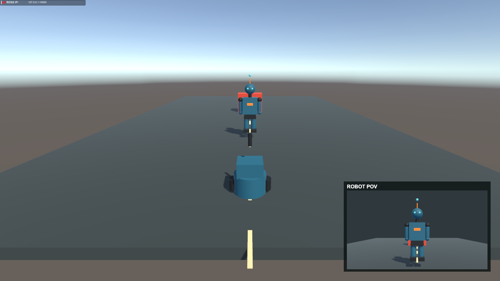

# Robot Observer Setup

The active scene is `HumanoidSimulation/Assets/Scenes/HumanoidSimulation.unity`.
It preserves the original ground, obstacle, lighting, ROS connection, waypoint
navigation, Main Camera, F1-F7 scenario controls, and robot-mounted camera. The
scene separates the mobile `RobotObserver` from the skinned `HumanTarget`.



## Scene hierarchy

```text
RobotObserver
|-- CharacterController
|-- RosAnimationController
|-- RobotPosePublisher
|-- RobotObserverScenarioControls
|-- RobotBody / UpperChassis / FrontSensor / Wheels
`-- CameraMount
    |-- MountStem
    `-- RobotEyeCamera
        `-- RobotCameraPublisher

HumanTarget
|-- CharacterController
|-- Animator (HumanTargetGestures controller and Humanoid Avatar)
|-- HumanTargetGestureController
`-- HumanVisual (imported FBX root has an Animator without a controller)
    |-- Armature (22 bones)
    `-- HumanVisualMesh (SkinnedMeshRenderer)

ROSConnection (click goals, HUD, existing TCP connection)
RobotPOVCanvas (Screen Space - Overlay)
`-- RobotPOVPanel/LivePreview (RawImage using RobotEyeRT)
Main Camera (ThirdPersonFollowCamera targets RobotObserver)
TargetObjectA / TargetObjectB
```

`RobotObserver` starts at `(0, 0, -9)`, facing Unity world `+Z`. The
`HumanTarget` starts at `(0, 0, -4)`. Its visual comes from the original,
locally generated `Assets/Characters/HumanTarget_Rigged.fbx`. It has a valid
Humanoid Avatar, 22 bones, and one `SkinnedMeshRenderer`; see
[HUMAN_TARGET_SETUP.md](HUMAN_TARGET_SETUP.md) for rig and gesture details.

## Robot camera and ROS output

`RobotEyeCamera` is parented under `RobotObserver/CameraMount`, 1.4 m above the
robot root. Its vertical FOV is 34.6 degrees (about 57.95 degrees horizontal at
16:9); clipping planes are 0.03 and 100 m. It renders the actual scene to the
existing 640 x 360 `RobotEyeRT`, which is also assigned to the preview
RawImage. The preview remains raw camera pixels without labels or perception
overlays.

`RobotCameraPublisher` reuses this camera and RenderTexture to publish
`/camera/image_raw` and `/camera/camera_info`. The RGB publisher does not add a
second camera or change the preview. `robot_camera_optical_frame` is the image
frame label; a TF transform for it is not yet published. Reproduction and
pixel conventions are in [ROS_CAMERA_PIPELINE.md](ROS_CAMERA_PIPELINE.md).

The MediaPipe node consumes the raw image and publishes predictions on
`/human_perception/detection` and `/human_perception/pose`; the debug overlay is
separate at `/human_perception/debug/image`. It never draws into the raw topic
or reads Unity target transforms. See [PERCEPTION_BASELINE.md](PERCEPTION_BASELINE.md).

## ROS control and scenario keys

The `RobotObserver` owns the sole `/cmd_vel` subscriber and `/robot/pose`
publisher. ROS-TCP-Connector 0.7.0 connects through the existing ROS 2 Jazzy
TCP endpoint at `127.0.0.1:10000`. `ROSConnection` also retains `/goal_pose` and
`/goal_cancel` for waypoint navigation. Normal movement remains on `/cmd_vel`;
scenario controls are for repeatable perception tests.

Click the Game view in Play Mode to focus keyboard input:

| Key | Scenario |
| --- | --- |
| F1 | Human in front |
| F2 | Human outside the initial camera FOV |
| F3 | Human behind observer |
| F4 | Observer turns toward human |
| F5 | Obstacle occludes human |
| F6 | Reset robot, human, and obstacle transforms |
| F7 | Human idle pose |
| F8 | Left-arm point toward TargetObjectA |
| F9 | Right-arm point toward TargetObjectB |

## Validation evidence

The live Unity/ROS validation confirmed the target in the RGB feed, no
perception detections in F2/F3/F5, and detections after turning in F4 and reset
in F6. `/cmd_vel`, `/robot/pose`, and waypoint navigation remain operational.
The evidence index and limitations are in
[NEXT_MILESTONE_REPORT.md](NEXT_MILESTONE_REPORT.md).
